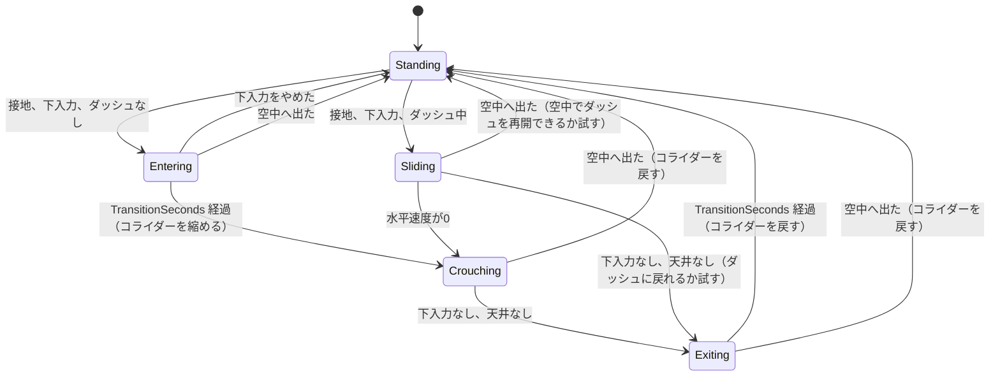

# ボディアタック・しゃがみ 実装書（実装後に削除する）

この文書は、しゃがみ（しゃがみ滑りを含む）とボディアタックを実装するための手順書。
文書の通りにコードを作れば、同じ結果になるようにしてある。実装が終わって仕様書へ反映したら、この文書は削除する。

- 仕様: [Crouch.md](../Specs/Crouch.md)、[BodyAttack.md](../Specs/BodyAttack.md)
- 構成の方針: [Responsibilities.md](Responsibilities.md)
- コードの書き方: [ReadableCode.md](../DeveloperGuides/ReadableCode.md)

## 0. 実装者へのルール
### 0.1. やること・やらないこと
- 手順 1 から順に、1手順ずつ実装する。各手順の終わりで、コンパイルエラーがないことを確認する。
- 文書のコードは、そのままファイルに作る。名前・コメント・順序を変えない。
- 文書に書いていない変更をしない（既存の動作を変えない）。
- 触ってよいのは、手順に書いた `.cs` ファイルだけ。次は触らない。
  - `.meta` ファイル、シーン（`.unity`）、`.asset`、`InputSystem_Actions.inputactions`（Unity で人が作業する。手順 7）
  - 仕様書（実装後に人が更新する。手順 9）
- 既存のコメントを消さない。

### 0.2. コードの書き方（ReadableCode.md の要点とこのプロジェクトの慣習）
命名
- 名前は、見ただけで用途が分かるドメインの言葉にする。`data`・`tmp`・`Manager`・`Helper` は使わない。
- 単位を名前に入れる: `…Seconds`（秒）、`…Units`（ユニット）、`…Multiplier`（倍率）、`…Speed`（ユニット/秒）。
- `bool` は `is…` / `has…` / `can…` / `was…` で始める。
- フィールド・ローカル変数は `camelCase`、型・メソッド・プロパティ・定数は `PascalCase`。`_` を付けない。
- マジックナンバーを書かない。設定アセットの項目か、名前付きの `const` にする。

関数
- 1つの関数は1つの責務だけを持つ。名前は、その責務を動詞で表す。
- 目安は20行以内。引数は5個以下。ネストは3段未満（早期 `return` で平らにする）。
- 条件が複雑なら、説明変数（`bool canStandUp = …`）に分ける。

コメント
- コメントは多めに書く。クラスの先頭、フィールドの右側、各ブロックの前に、日本語で書く。
- 「何をしているか」だけでなく「なぜそうするか」を書く。
- フィールドの説明は、同じ行の右側に `//` で書く（既存コードと同じ）。

### 0.3. 依頼するときの指示文（例）
> `Docs/Notes/ボディアタックしゃがみ実装書実装後削除予定.md` の「手順 N」を実装してください。
> 文書のコードをそのままファイルに作り、コメントも変えないでください。
> 手順に書いていないファイルは変更しないでください。
> 終わったら、コンパイルエラーがないことと、「完了条件」を確認して報告してください。

## 1. 全体像
### 1.1. 手順の一覧
| 手順 | 内容 | 作るファイル（`Assets/_Project/Features/Player/Scripts/` 配下） |
|---|---|---|
| 1 | 設定クラス | `Settings/CrouchSettings.cs`、`Settings/BodyAttackSettings.cs` |
| 2 | 部品クラス | `Abilities/ShrinkableCollider.cs`、`Abilities/CeilingCheck.cs`、`Abilities/WallCheck.cs` |
| 3 | 既存クラスの変更 | `Abilities/BasicMove.cs`、`Abilities/Facing.cs`、`Abilities/Dash.cs`、`PlayerMover.cs`（呼び出しの修正だけ） |
| 4 | しゃがみ | `Abilities/Crouch.cs` |
| 5 | ボディアタック | `Abilities/BodyAttack.cs` |
| 6 | 組み立て | `PlayerMover.cs`（全体を置き換え）、`PlayerVisual.cs`（全体を置き換え） |
| 7 | Unity での作業（人が行う） | Input Action、設定アセット、子オブジェクト、Inspector |
| 8 | 動作確認（人が行う） | チェックリスト |
| 9 | 後始末（人が行う） | 仕様書の更新、この文書の削除 |

### 1.2. クラスの関係
```
PlayerMover（MonoBehaviour。入力を読み、下のクラスを決まった順に呼ぶ）
 ├─ GroundCheck       接地判定（既存）
 ├─ CeilingCheck      頭上の天井の判定（新規）
 ├─ WallCheck         進む向きの壁の判定（新規）
 ├─ ShrinkableCollider  コライダーの縮小・復元。しゃがみとボディアタックが共用（新規）
 ├─ Jump / Dive / BasicMove / Facing   （既存）
 ├─ Dash              ダッシュ・ブレーキ（変更あり）
 ├─ Crouch            しゃがみ・しゃがみ滑り（新規）
 └─ BodyAttack        ボディアタック（新規）
PlayerVisual（MonoBehaviour。PlayerMover の状態からスプライトを選ぶ）
```
機能のクラスどうしは直接参照しない。値の受け渡しは `PlayerMover` が行う（Responsibilities.md の方針）。

### 1.3. 毎フレームの処理順（`FixedUpdate`）
順序には意味がある。変えない。

| 順 | 処理 | 理由 |
|---|---|---|
| 1 | 接地判定 | 以降すべてが接地状態を使う |
| 2 | ジャンプ | 後続の水平移動が、ジャンプの速度を上書きしないよう先に行う |
| 3 | しゃがみの状態遷移 | ジャンプで空中に出たときに、先にしゃがみを解除する。ボディアタックの発動より前に行い、コライダーの復元と衝突させない |
| 4 | ボディアタックの開始 | しゃがみの解除後に、空中の状態を見て発動する |
| 5 | 急降下 | ボディアタック中は行わない |
| 6 | ダッシュの状態遷移 | しゃがみ・ボディアタック中は、新しく始めない |
| 7 | 向き | ブレーキ・滑り・ボディアタック中は更新しない |
| 8 | 重力 | 停止中は重力を切る |
| 9 | 水平移動 | 優先順位は 1.4 |
| 10 | ボディアタックの終了判定 | 水平移動の後に、着地・壁を見る |
| 11 | 落下速度の制限 | 最終的な速度を制限する |

### 1.4. 水平移動の優先順位（上ほど優先）
| 優先 | 条件 | 誰が速度を決めるか |
|---|---|---|
| 1 | ボディアタック中 | `BodyAttack`（水平速度を保つ） |
| 2 | しゃがみ滑り中 | `Crouch`（摩擦で減速） |
| 3 | ダッシュ有効 | `Dash` |
| 4 | しゃがむ移行中・立ち上がる解除中 | `Crouch`（速度0。移動できない） |
| 5 | それ以外 | `BasicMove`（しゃがみ中は最高速に倍率を掛ける） |

### 1.5. しゃがみの状態遷移


## 2. 手順 1: 設定クラス
目的: パラメータをスクリプトに埋めず、`ScriptableObject` に出す。既存の `JumpSettings` などと同じ形にする。

### 2.1. `Settings/CrouchSettings.cs`
```csharp
using UnityEngine;

// しゃがみ・しゃがみ滑りのパラメータ。値の意味は Docs/Specs/Crouch.md を参照
[CreateAssetMenu(fileName = "CrouchSettings", menuName = "Scriptable Objects/CrouchSettings")]
public class CrouchSettings : ScriptableObject
{
    [field: SerializeField] public float StickThreshold { get; private set; } = 0.6f; // しゃがむとみなすスティックの下方向の倒し量（0〜1）。急降下の閾値とは別に持つ
    [field: SerializeField] public float WalkSpeedMultiplier { get; private set; } = 0.4f; // しゃがみ歩きの最高速の倍率（歩きの MoveSpeed に掛ける）
    [field: SerializeField] public float SlideDeceleration { get; private set; } = 35f; // しゃがみ滑りで水平速度を0へ近づける強さ（ユニット/秒²）。滑る時間はこれだけで決まる
    [field: SerializeField] public float DashEntrySpeed { get; private set; } = 28f; // 滑りを解除してダッシュに移るときの水平速度（ユニット/秒）。減速した現在の速度ではなくこの値から入る
    [field: SerializeField] public float TransitionSeconds { get; private set; } = 0.08f; // しゃがむ移行と立ち上がる解除にかける時間（秒）。滑りでコライダーを縮めるまでの時間にも使う
    [field: SerializeField] public float CrouchColliderHeightMultiplier { get; private set; } = 0.5f; // しゃがんだときのコライダーの高さ（y）に掛ける倍率。幅（x）は変えない
}
```

### 2.2. `Settings/BodyAttackSettings.cs`
```csharp
using UnityEngine;

// ボディアタックのパラメータ。値の意味は Docs/Specs/BodyAttack.md を参照
[CreateAssetMenu(fileName = "BodyAttackSettings", menuName = "Scriptable Objects/BodyAttackSettings")]
public class BodyAttackSettings : ScriptableObject
{
    [field: SerializeField] public float Speed { get; private set; } = 22f; // 水平速度の基準値（ユニット/秒）。歩きの最高速とダッシュの最高速の間にする
    [field: SerializeField] public float UpwardSpeed { get; private set; } = 15f; // 発動時に与える上向き速度（ユニット/秒）。「やや上に」飛び込む高さを決める
    [field: SerializeField] public float TransitionSeconds { get; private set; } = 0.08f; // 発動してからコライダーを縮めるまでの時間（秒）。しゃがみの TransitionSeconds と同じ数値だが、設定は別に持つ
    [field: SerializeField] public float BufferSeconds { get; private set; } = 0.08f; // 発動できる前に押したボタンを保持する時間（秒）。ジャンプの先行入力と同じ数値
}
```

完了条件: コンパイルエラーがない。

## 3. 手順 2: 部品クラス
目的: 機能のクラスが使う、小さな判定・変形の部品を作る。

### 3.1. `Abilities/ShrinkableCollider.cs`
```csharp
using UnityEngine;

// カプセルコライダーの高さを縮める・元に戻す。
// しゃがみとボディアタックは当たり判定を共有するので、1つのインスタンスを両方が使う
public class ShrinkableCollider
{
    readonly CapsuleCollider2D capsule;
    readonly Vector2 standingSize; // 立っているときの大きさ
    readonly Vector2 standingOffset; // 立っているときのオフセット
    readonly float shrunkHeight; // 縮めたときの高さ（ユニット）

    // 縮んでいるか。Shrink / Restore を重ねて呼んでも安全にするために持つ
    public bool IsShrunk { get; private set; }

    public ShrinkableCollider(CapsuleCollider2D capsule, float heightMultiplier)
    {
        this.capsule = capsule;
        standingSize = capsule.size;
        standingOffset = capsule.offset;
        shrunkHeight = standingSize.y * heightMultiplier;
    }

    // 高さ（y）だけを縮め、幅（x）は変えない。
    // 足元の位置を保つため、減った高さの半分だけ offset の y を下げる
    public void Shrink()
    {
        if (IsShrunk) return;

        float reducedHeight = standingSize.y - shrunkHeight;
        capsule.size = new Vector2(standingSize.x, shrunkHeight);
        capsule.offset = new Vector2(standingOffset.x, standingOffset.y - reducedHeight / 2f);
        IsShrunk = true;
    }

    // 立っているときの大きさに戻す
    public void Restore()
    {
        if (!IsShrunk) return;

        capsule.size = standingSize;
        capsule.offset = standingOffset;
        IsShrunk = false;
    }
}
```

### 3.2. `Abilities/CeilingCheck.cs`
```csharp
using UnityEngine;

// 立ち上がったときに頭が入る領域に、天井（床と同じレイヤーのもの）があるかを調べる。
// GroundCheck と同じように、位置・大きさ・レイヤーは PlayerMover から渡す
public class CeilingCheck
{
    readonly Transform origin; // 調べる領域の中心
    readonly Vector2 boxSize; // 調べる領域の大きさ
    readonly LayerMask layerMask; // 天井とみなすレイヤー

    public CeilingCheck(Transform origin, Vector2 boxSize, LayerMask layerMask)
    {
        this.origin = origin;
        this.boxSize = boxSize;
        this.layerMask = layerMask;
    }

    // 領域の中に天井があれば、立ち上がれない
    public bool IsBlocked()
    {
        Collider2D ceiling = Physics2D.OverlapBox(origin.position, boxSize, 0f, layerMask);
        return ceiling != null;
    }
}
```

### 3.3. `Abilities/WallCheck.cs`
```csharp
using UnityEngine;

// 進む向きの先に、壁がコライダーで接しているかを調べる。
// ボディアタックが壁に当たって終わるかを決めるために使う
public class WallCheck
{
    const int MaxContactCount = 8; // 一度に調べる接触点の最大数。毎フレームの確保（GC）を避けるため、配列を使い回す

    readonly Rigidbody2D body;
    readonly float minWallNormalAbsX; // 壁とみなす面の法線 x の絶対値の下限（床や斜面を壁扱いにしないため）
    readonly ContactPoint2D[] contactBuffer = new ContactPoint2D[MaxContactCount];

    public WallCheck(Rigidbody2D body, float minWallNormalAbsX)
    {
        this.body = body;
        this.minWallNormalAbsX = minWallNormalAbsX;
    }

    // 進む向き（-1 / 1）の先に、法線がほぼ水平な面が接しているか。
    // 接触の法線は「相手から自分へ向く」ので、壁が進む向きにあるなら、法線は進む向きと逆を向く。
    // 逆向きの壁（背中側）には反応させない。動作確認（手順 8）で向きが逆なら、比較の符号を反転する
    public bool IsTouchingWallAhead(float moveDirection)
    {
        int contactCount = body.GetContacts(contactBuffer);

        for (int contactIndex = 0; contactIndex < contactCount; contactIndex++)
        {
            float normalAlongMove = contactBuffer[contactIndex].normal.x * moveDirection;
            bool isWallAhead = normalAlongMove <= -minWallNormalAbsX;
            if (isWallAhead) return true;
        }

        return false;
    }
}
```

完了条件: コンパイルエラーがない。

## 4. 手順 3: 既存クラスの変更
目的: しゃがみ・ボディアタックが必要とする入口を、既存クラスに足す。ファイルを置き換える。

### 4.1. `Abilities/BasicMove.cs`（全体を置き換え）
変更点: `UpdateVelocity` が最高速の倍率を受け取る。しゃがみ歩きで最高速を下げるため。

```csharp
using UnityEngine;

public class BasicMove
{
    readonly Rigidbody2D body;
    readonly BasicMoveSettings settings;

    public BasicMove(Rigidbody2D body, BasicMoveSettings settings)
    {
        this.body = body;
        this.settings = settings;
    }

    // 接地していて、左右入力もしない。走行や減速の最中かは呼び出し側が見る
    public bool IsStandingStill(bool isGrounded, float horizontalInput) =>
        isGrounded && horizontalInput == 0f;

    // 力を加えず速度を直接書き換えるので、摩擦や壁との接触の影響を受けにくい。
    // maxSpeedMultiplier は歩きの最高速に掛ける倍率（しゃがみ歩きは小さくする。通常は 1）
    public void UpdateVelocity(MoveInput input, bool isGrounded, float maxSpeedMultiplier)
    {
        // 端での押し出しによる滑りを止める
        if (IsStandingStill(isGrounded, input.Horizontal))
        {
            body.linearVelocity = Vector2.zero;
            return;
        }

        // 空中で左右を離している間は、弱い減速で速度を残す。入力があれば空中の加速で操作する
        float acceleration;
        if (isGrounded) acceleration = settings.GroundAcceleration;
        else if (input.Horizontal == 0f) acceleration = settings.AirDeceleration;
        else acceleration = settings.AirAcceleration;

        // 最高速ダッシュの反転はブレーキ状態が担当する。それ以外の反転はここで加速度を上げて素早く切り返す
        bool isReversing = Mathf.Abs(input.Horizontal) >= settings.HoldThreshold
            && input.Horizontal * body.linearVelocity.x < 0f;
        if (isReversing) acceleration *= settings.ReverseAccelerationMultiplier;

        float targetSpeed = input.Horizontal * settings.MoveSpeed * maxSpeedMultiplier;
        body.MoveVelocityXTowards(targetSpeed, acceleration);
    }
}
```

### 4.2. `Abilities/Facing.cs`（全体を置き換え）
変更点: `Step` の第2引数を「ブレーキ中か」から「更新を止めるか」に一般化する。`Set` を追加する（ボディアタックが向きを決めるため）。

```csharp
using UnityEngine;

public class Facing
{
    readonly BasicMoveSettings settings;

    public float Direction { get; private set; } = 1f; // -1 / 1。入力を離しても維持する

    public Facing(BasicMoveSettings settings)
    {
        this.settings = settings;
    }

    // 左右を倒している間だけ向きを更新する。
    // isLocked が true の間（ブレーキ・しゃがみ滑り・ボディアタック）は、逆入力でも元の向きを保つ
    public void Step(float horizontalInput, bool isLocked)
    {
        if (isLocked) return;
        if (Mathf.Abs(horizontalInput) < settings.HoldThreshold) return;

        Direction = Mathf.Sign(horizontalInput);
    }

    // 入力とは関係なく、向きを決める（ボディアタックの発動時に使う）
    public void Set(float direction) => Direction = direction;

    public void Reset() => Direction = 1f;
}
```

### 4.3. `Abilities/Dash.cs`（全体を置き換え）
変更点
- `UpdateState` に `isStartAllowed` を足す。しゃがんでいる間、ボディアタック中は、ダッシュに新しく入らない。
- 開始条件を `CanStartDash` に切り出す。
- `TryStartFromSlide`（滑りの解除で、基準速度からダッシュに入る）を足す。
- `TryResumeInAir`（滑り中に空中へ出たとき、現在の速度のままダッシュを再開する）を足す。

```csharp
using UnityEngine;

public enum DashState
{
    Inactive, // ダッシュしていない
    Dash, // ダッシュボタン押下中の走行。接地中に入り、空中では維持する
    Brake, // 最高速からの反転時の減速。BrakeDuration の間続く
}

public class Dash
{
    const float SpeedTolerance = 0.01f; // 最高速とみなす速度の誤差（ユニット/秒）

    readonly Rigidbody2D body;
    readonly DashSettings dashSettings;
    readonly BasicMoveSettings moveSettings; // 空中の加減速と HoldThreshold を歩きと共有する
    float dashDirection; // ダッシュの向き（-1 / 1）
    float brakeRemainingSeconds; // ブレーキ状態の残り時間（秒）

    public DashState State { get; private set; } = DashState.Inactive;
    public bool IsActive => State != DashState.Inactive;
    public bool IsBraking => State == DashState.Brake;

    public Dash(Rigidbody2D body, DashSettings dashSettings, BasicMoveSettings moveSettings)
    {
        this.body = body;
        this.dashSettings = dashSettings;
        this.moveSettings = moveSettings;
    }

    // 状態を進める。状態が変わるのはこのメソッドと TryStart… だけにする。
    // isStartAllowed が false の間は、ダッシュしていない状態から新しく入らない
    // （しゃがみ中・ボディアタック中は入れない）。すでにダッシュ・ブレーキ中の状態は、通常どおり進める
    public void UpdateState(MoveInput input, bool isGrounded, bool isStartAllowed)
    {
        bool isHoldingInput = Mathf.Abs(input.Horizontal) >= moveSettings.HoldThreshold;
        float inputDirection = Mathf.Sign(input.Horizontal);
        float currentX = body.linearVelocity.x;

        switch (State)
        {
            case DashState.Inactive:
                if (isStartAllowed && CanStartDash(input, isGrounded)) StartDash(inputDirection);
                break;

            case DashState.Dash:
                if (!input.IsDashHeld)
                {
                    State = DashState.Inactive;
                }
                else if (isHoldingInput && inputDirection != dashDirection)
                {
                    // 最高速からの反転だけブレーキを挿む。それ以外は歩きの反転として扱う
                    bool isAtMaxSpeed = Mathf.Abs(currentX) >= dashSettings.MaxDashSpeed - SpeedTolerance;
                    if (isAtMaxSpeed) StartBrake();
                    else State = DashState.Inactive;
                }
                else if (!isHoldingInput && isGrounded)
                {
                    State = DashState.Inactive;
                }
                break;

            case DashState.Brake:
                brakeRemainingSeconds -= Time.fixedDeltaTime;
                if (brakeRemainingSeconds <= 0f)
                {
                    if (input.IsDashHeld && isHoldingInput) StartDash(inputDirection);
                    else State = DashState.Inactive;
                }
                break;
        }
    }

    // しゃがみ滑りを解除した直後に、ダッシュの開始条件を満たしていれば、ダッシュに入る。
    // このとき水平速度は、減速した現在の値ではなく、基準速度（entrySpeed）から入る。入れたかを返す
    public bool TryStartFromSlide(MoveInput input, bool isGrounded, float entrySpeed)
    {
        if (!CanStartDash(input, isGrounded)) return false;

        float direction = Mathf.Sign(input.Horizontal);
        StartDash(direction);
        body.linearVelocity = new Vector2(direction * entrySpeed, body.linearVelocity.y);
        return true;
    }

    // しゃがみ滑りの途中で空中へ出た（ジャンプなど）ときに、ダッシュボタンを押していれば、
    // 現在の速度のまま空中でダッシュ状態を再開する。再開したかを返す。
    // 通常のダッシュは空中では始められないので、開始条件を見ずに入る
    public bool TryResumeInAir(MoveInput input, float direction)
    {
        if (!input.IsDashHeld) return false;

        StartDash(direction);
        return true;
    }

    // ダッシュ中は最高速へ近づける。空中では加速を弱め、入力を離した空中では弱い減速で速度を残す。
    // ブレーキ中は速度を0へ近づける
    public void UpdateVelocity(MoveInput input, bool isGrounded)
    {
        if (State == DashState.Brake)
        {
            body.MoveVelocityXTowards(0f, dashSettings.BrakeAcceleration);
            return;
        }

        if (Mathf.Abs(input.Horizontal) < moveSettings.HoldThreshold)
        {
            body.MoveVelocityXTowards(0f, moveSettings.AirDeceleration);
            return;
        }

        float acceleration = isGrounded ? dashSettings.DashAcceleration : moveSettings.AirAcceleration;
        body.MoveVelocityXTowards(dashDirection * dashSettings.MaxDashSpeed, acceleration);
    }

    public void Reset() => State = DashState.Inactive;

    // 接地中、ダッシュボタンを押している、左右を倒している、現在の速度と同じ向き。
    // 逆向きに走っている途中は、速度が0になるまでダッシュに入らない
    bool CanStartDash(MoveInput input, bool isGrounded)
    {
        bool isHoldingInput = Mathf.Abs(input.Horizontal) >= moveSettings.HoldThreshold;
        float currentX = body.linearVelocity.x;
        bool isSameDirectionAsVelocity =
            Mathf.Approximately(currentX, 0f) || Mathf.Sign(currentX) == Mathf.Sign(input.Horizontal);

        return isGrounded && input.IsDashHeld && isHoldingInput && isSameDirectionAsVelocity;
    }

    void StartDash(float direction)
    {
        State = DashState.Dash;
        dashDirection = direction;
    }

    void StartBrake()
    {
        State = DashState.Brake;
        brakeRemainingSeconds = dashSettings.BrakeDuration;
    }
}
```

### 4.4. `PlayerMover.cs`（呼び出しの修正だけ。この手順でコンパイルを通すため）
手順 6 で全体を置き換えるので、ここでは次の3か所だけ直す。
1. `dash?.UpdateState(input, isGrounded);` → `dash?.UpdateState(input, isGrounded, true);`
2. `basicMove.UpdateVelocity(input, isGrounded);` → `basicMove.UpdateVelocity(input, isGrounded, 1f);`
3. `facing.Step(input.Horizontal, dash != null && dash.IsBraking);` は変更なし（第2引数の意味が一般化されただけ）

完了条件: コンパイルエラーがない。

## 5. 手順 4: しゃがみ
### 5.1. `Abilities/Crouch.cs`
責務: しゃがみの姿勢の状態遷移と、水平速度（滑り・移行中）の決定。コライダーの縮小・復元は `ShrinkableCollider` に任せる。

```csharp
using UnityEngine;

// しゃがみの姿勢の状態
public enum CrouchState
{
    Standing, // 立っている
    Entering, // しゃがむ移行中（TransitionSeconds の間）。移動できず、コライダーはまだ立ちのまま
    Crouching, // しゃがんでいる（しゃがみ歩きを含む）。コライダーは小さい
    Exiting, // 立ち上がる解除中（TransitionSeconds の間）。移動できず、コライダーはまだ小さいまま
    Sliding, // しゃがみ滑り中。入ってから TransitionSeconds 後にコライダーが小さくなる
}

// UpdateState で起きた状態の変化。PlayerMover が、ダッシュとの受け渡しに使う
public enum CrouchTransition
{
    None, // 受け渡しが必要な変化はなかった
    StartedCrouching, // しゃがむ移行を始めた（ダッシュ状態を解除する）
    StartedSliding, // しゃがみ滑りに入った（ダッシュ状態を解除する）
    ReleasedSlideOnGround, // 地上でしゃがみ滑りを解除した（ダッシュに戻れるか試す）
    LeftSlideInAir, // しゃがみ滑りの途中で空中へ出た（空中でダッシュを再開できるか試す）
}

// しゃがみ・しゃがみ滑りを担当する。
// 流れ: 立ち → しゃがむ移行 → しゃがみ → 立ち上がる解除 → 立ち。ダッシュ中にしゃがむと、しゃがみ滑りに入る
public class Crouch
{
    const float StoppedSpeedTolerance = 0.01f; // 水平速度がこの値以下なら、止まったとみなす（ユニット/秒）

    readonly Rigidbody2D body;
    readonly CrouchSettings settings;
    readonly BasicMoveSettings moveSettings; // ブレーキ中にしゃがんだときの、滑りか通常のしゃがみかの境目に、歩きの最高速を使う
    readonly ShrinkableCollider bodyCollider; // ボディアタックと共有する当たり判定
    float transitionRemainingSeconds; // 移行・解除・滑りでコライダーを縮めるまでの、残り時間（秒）

    public CrouchState State { get; private set; } = CrouchState.Standing;
    public float SlideDirection { get; private set; } = 1f; // 滑っている向き（-1 / 1）

    public bool IsSliding => State == CrouchState.Sliding;
    public bool IsTransitioning => State == CrouchState.Entering || State == CrouchState.Exiting;
    public bool IsCrouched => State != CrouchState.Standing; // 移行中・解除中・滑りも含む

    public Crouch(
        Rigidbody2D body,
        CrouchSettings settings,
        BasicMoveSettings moveSettings,
        ShrinkableCollider bodyCollider)
    {
        this.body = body;
        this.settings = settings;
        this.moveSettings = moveSettings;
        this.bodyCollider = bodyCollider;
    }

    // 状態を進める。状態が変わるのはこのメソッドと ForceCrouching だけにする。
    // 起きた変化を返し、ダッシュとの受け渡しは呼び出し側が行う。
    // hasCeiling は、立ち上がる解除に入る瞬間にだけ見る（解除の途中では見ない）
    public CrouchTransition UpdateState(
        MoveInput input,
        bool isGrounded,
        bool isDashActive,
        bool isDashBraking,
        bool hasCeiling)
    {
        // 空中ではしゃがみの姿勢を保てない
        if (!isGrounded) return LeaveToAir();

        bool isHoldingDown = input.Vertical <= -settings.StickThreshold;

        switch (State)
        {
            case CrouchState.Standing:
                return UpdateStanding(input, isHoldingDown, isDashActive, isDashBraking);

            case CrouchState.Entering:
                UpdateEntering(isHoldingDown);
                return CrouchTransition.None;

            case CrouchState.Crouching:
                UpdateCrouching(isHoldingDown, hasCeiling);
                return CrouchTransition.None;

            case CrouchState.Exiting:
                UpdateExiting();
                return CrouchTransition.None;

            case CrouchState.Sliding:
                return UpdateSliding(isHoldingDown, hasCeiling);

            default:
                return CrouchTransition.None;
        }
    }

    // 滑り中は摩擦で減速する。移行中・解除中は動かない（速度を0にする）。それ以外では何もしない
    public void UpdateVelocity()
    {
        switch (State)
        {
            case CrouchState.Sliding:
                body.MoveVelocityXTowards(0f, settings.SlideDeceleration);
                break;

            case CrouchState.Entering:
            case CrouchState.Exiting:
                body.linearVelocity = Vector2.zero;
                break;
        }
    }

    // ボディアタックが天井の下で着地したとき、立てないのでしゃがみにする。
    // コライダーはボディアタックが縮めたままなので、状態だけを合わせる
    public void ForceCrouching()
    {
        State = CrouchState.Crouching;
        bodyCollider.Shrink();
    }

    // リスポーンなどで、立ちの状態とコライダーに戻す
    public void Reset()
    {
        State = CrouchState.Standing;
        transitionRemainingSeconds = 0f;
        bodyCollider.Restore();
    }

    // 立っているとき: 下入力があれば、滑りに入るか、しゃがむ移行に入る
    CrouchTransition UpdateStanding(
        MoveInput input,
        bool isHoldingDown,
        bool isDashActive,
        bool isDashBraking)
    {
        if (!isHoldingDown) return CrouchTransition.None;

        if (CanSlide(isDashActive, isDashBraking))
        {
            StartSliding(input);
            return CrouchTransition.StartedSliding;
        }

        StartEntering();
        return CrouchTransition.StartedCrouching;
    }

    // ダッシュ中なら滑れる。ただしブレーキ中は、水平速度が歩きの最高速以下なら滑らず、通常のしゃがみにする。
    // ブレーキでは速度がすぐ落ちるので、ブレーキ中は基本的に通常のしゃがみになる
    bool CanSlide(bool isDashActive, bool isDashBraking)
    {
        if (!isDashActive) return false;

        bool isBrakingNotFasterThanWalk =
            isDashBraking && Mathf.Abs(body.linearVelocity.x) <= moveSettings.MoveSpeed;
        return !isBrakingNotFasterThanWalk;
    }

    // しゃがむ移行中: 下入力をやめたら立ちに戻る。時間が経ったらしゃがみになり、コライダーを縮める
    void UpdateEntering(bool isHoldingDown)
    {
        // 移行の途中でスティックを戻した。コライダーはまだ変えていないので、状態を戻すだけでよい
        if (!isHoldingDown)
        {
            State = CrouchState.Standing;
            return;
        }

        transitionRemainingSeconds -= Time.fixedDeltaTime;
        if (transitionRemainingSeconds > 0f) return;

        State = CrouchState.Crouching;
        bodyCollider.Shrink();
    }

    // しゃがんでいるとき: 下入力をやめて、頭上に天井がなければ、立ち上がる解除に入る。
    // 天井があれば立てないので、しゃがんだままにする
    void UpdateCrouching(bool isHoldingDown, bool hasCeiling)
    {
        bool canStandUp = !isHoldingDown && !hasCeiling;
        if (canStandUp) StartExiting();
    }

    // 立ち上がる解除中: 時間が経ったら立ちに戻り、コライダーを元に戻す
    void UpdateExiting()
    {
        transitionRemainingSeconds -= Time.fixedDeltaTime;
        if (transitionRemainingSeconds > 0f) return;

        State = CrouchState.Standing;
        bodyCollider.Restore();
    }

    // しゃがみ滑り中: 解除できるなら解除し、止まったらしゃがみにし、それ以外は滑りを続ける
    CrouchTransition UpdateSliding(bool isHoldingDown, bool hasCeiling)
    {
        bool canStandUp = !isHoldingDown && !hasCeiling;
        if (canStandUp)
        {
            StartExiting();
            return CrouchTransition.ReleasedSlideOnGround;
        }

        bool hasStopped = Mathf.Abs(body.linearVelocity.x) <= StoppedSpeedTolerance;
        if (hasStopped)
        {
            State = CrouchState.Crouching;
            bodyCollider.Shrink();
            return CrouchTransition.None;
        }

        ShrinkColliderAfterTransition();
        return CrouchTransition.None;
    }

    // 滑りに入ってから TransitionSeconds が経ったら、コライダーを縮める（滑り自体は入った時点から始まる）
    void ShrinkColliderAfterTransition()
    {
        transitionRemainingSeconds -= Time.fixedDeltaTime;
        if (transitionRemainingSeconds <= 0f) bodyCollider.Shrink();
    }

    // 空中に出たら、姿勢を立ちに戻してコライダーを元に戻す。
    // 滑りの途中だったなら、空中でダッシュを再開できるように知らせる
    CrouchTransition LeaveToAir()
    {
        if (State == CrouchState.Standing) return CrouchTransition.None;

        bool wasSliding = IsSliding;
        State = CrouchState.Standing;
        bodyCollider.Restore();
        return wasSliding ? CrouchTransition.LeftSlideInAir : CrouchTransition.None;
    }

    void StartEntering()
    {
        State = CrouchState.Entering;
        transitionRemainingSeconds = settings.TransitionSeconds;
    }

    void StartExiting()
    {
        State = CrouchState.Exiting;
        transitionRemainingSeconds = settings.TransitionSeconds;
    }

    // 滑りの向きは、今の水平速度の向きにする。ほぼ止まっているなら、左右入力の向きにする
    void StartSliding(MoveInput input)
    {
        State = CrouchState.Sliding;
        transitionRemainingSeconds = settings.TransitionSeconds;

        float velocityX = body.linearVelocity.x;
        bool isAlmostStopped = Mathf.Abs(velocityX) <= StoppedSpeedTolerance;
        SlideDirection = Mathf.Sign(isAlmostStopped ? input.Horizontal : velocityX);
    }
}
```

完了条件: コンパイルエラーがない。

## 6. 手順 5: ボディアタック
### 6.1. `Abilities/BodyAttack.cs`
責務: 空中での発動の判定、発動中の水平速度の維持、着地・壁での終了。コライダーの縮小・復元は `ShrinkableCollider` に任せる。

```csharp
using UnityEngine;

// ボディアタックの終わり方。PlayerMover が、しゃがみとの受け渡しに使う
public enum BodyAttackEnd
{
    NotEnded, // 終わっていない（または発動していない）
    Ended, // 終わった。コライダーは元に戻した
    EndedUnderCeiling, // 天井の下に着地して終わった。立てないので、コライダーは小さいまま残す
}

// ボディアタックを担当する。空中で前方へ、やや上に大きく飛び込む。
// 放物線（初速 + 重力）で飛び、着地か壁で終わる。重力は PlayerMover 側（Jump）が通常どおり掛ける
public class BodyAttack
{
    // 「まだ一度も押されていない」を表す。経過時間が無限大になり、受付時間内と判定されない
    const float NoTime = float.NegativeInfinity;

    readonly Rigidbody2D body;
    readonly BodyAttackSettings settings;
    readonly BasicMoveSettings moveSettings; // 左右入力を「倒している」とみなす HoldThreshold を使う
    readonly ShrinkableCollider bodyCollider; // しゃがみと共有する当たり判定
    float lastAttackPressedTime = NoTime; // 最後にボタンを押した時刻（先行入力用）
    bool hasUsedInThisAirtime; // 今の滞空で、すでに発動したか。着地で false に戻る
    float colliderShrinkRemainingSeconds; // コライダーを縮めるまでの残り時間（秒）
    float horizontalSpeed; // 発動中に保つ水平速度の大きさ（ユニット/秒。0以上）

    public bool IsActive { get; private set; }
    public float Direction { get; private set; } = 1f; // 飛ぶ向き（-1 / 1）

    public BodyAttack(
        Rigidbody2D body,
        BodyAttackSettings settings,
        BasicMoveSettings moveSettings,
        ShrinkableCollider bodyCollider)
    {
        this.body = body;
        this.settings = settings;
        this.moveSettings = moveSettings;
        this.bodyCollider = bodyCollider;
    }

    // 押した時刻を記録するだけにする。実際の発動は TryStart で、
    // 空中かどうかと合わせて決める（先行入力のため）
    public void RequestAttack() => lastAttackPressedTime = Time.time;

    // 発動できる条件がそろっていれば発動する。発動したかを返す。
    // 条件: 押した直後（BufferSeconds 以内）、発動中でない、空中、今の滞空でまだ使っていない。
    // maxHorizontalSpeed は、引き継ぐ速度の上限（ダッシュの最高速）
    public bool TryStart(MoveInput input, float facingDirection, bool isGrounded, float maxHorizontalSpeed)
    {
        bool wasPressedRecently = Time.time - lastAttackPressedTime <= settings.BufferSeconds;
        bool canStart = wasPressedRecently && !IsActive && !isGrounded && !hasUsedInThisAirtime;
        if (!canStart) return false;

        // 向きを先に決める。引き継ぐ速度は、この向きに対する速度で比べるため
        Direction = DecideDirection(input, facingDirection);
        horizontalSpeed = DecideHorizontalSpeed(maxHorizontalSpeed);
        body.linearVelocity = new Vector2(Direction * horizontalSpeed, settings.UpwardSpeed);

        IsActive = true;
        hasUsedInThisAirtime = true;
        lastAttackPressedTime = NoTime; // 同じ押下で2回発動しない
        colliderShrinkRemainingSeconds = settings.TransitionSeconds;
        return true;
    }

    // 発動中は、水平速度を一定に保つ（左右入力や空中の減速で変えない）。垂直方向は重力に任せる
    public void UpdateVelocity()
    {
        body.linearVelocity = new Vector2(Direction * horizontalSpeed, body.linearVelocity.y);
    }

    // 毎フレームの終わりに呼ぶ。発動中なら終了条件を見て、発動中でなければ着地で回復する。
    // isTouchingWallAhead は発動中だけ意味を持つ。hasCeiling は着地で終わるときだけ使う
    public BodyAttackEnd Step(bool isGrounded, bool isTouchingWallAhead, bool hasCeiling)
    {
        if (!IsActive)
        {
            RecoverIfGrounded(isGrounded);
            return BodyAttackEnd.NotEnded;
        }

        if (isTouchingWallAhead) return EndByWall();
        if (isGrounded) return EndByLanding(hasCeiling);

        ShrinkColliderAfterTransition();
        return BodyAttackEnd.NotEnded;
    }

    // リスポーンなどで、発動前の状態に戻す
    public void Reset()
    {
        IsActive = false;
        hasUsedInThisAirtime = false;
        lastAttackPressedTime = NoTime;
        bodyCollider.Restore();
    }

    // 左右を倒していればその方向、倒していなければキャラの向き
    float DecideDirection(MoveInput input, float facingDirection)
    {
        bool isHoldingHorizontal = Mathf.Abs(input.Horizontal) >= moveSettings.HoldThreshold;
        return isHoldingHorizontal ? Mathf.Sign(input.Horizontal) : facingDirection;
    }

    // 基準値（Speed）と、発動時点の速度（同じ向きのもの）のうち、速いほうにする。
    // ただし上限（ダッシュの最高速）は超えない。逆向きの速度は、負の値になるので基準値が選ばれる
    float DecideHorizontalSpeed(float maxHorizontalSpeed)
    {
        float inheritedSpeed = body.linearVelocity.x * Direction;
        float baseOrInheritedSpeed = Mathf.Max(settings.Speed, inheritedSpeed);
        return Mathf.Min(baseOrInheritedSpeed, maxHorizontalSpeed);
    }

    // 発動してから TransitionSeconds が経ったら、コライダーを縮める
    void ShrinkColliderAfterTransition()
    {
        colliderShrinkRemainingSeconds -= Time.fixedDeltaTime;
        if (colliderShrinkRemainingSeconds <= 0f) bodyCollider.Shrink();
    }

    // 壁に当たったら終わる。水平速度を0にして、壁に押し付け続けないようにする
    BodyAttackEnd EndByWall()
    {
        body.linearVelocity = new Vector2(0f, body.linearVelocity.y);
        IsActive = false;
        bodyCollider.Restore();
        return BodyAttackEnd.Ended;
    }

    // 着地したら終わる。頭上に天井があって立てないなら、コライダーを縮めたまま残して知らせる
    BodyAttackEnd EndByLanding(bool hasCeiling)
    {
        IsActive = false;
        if (hasCeiling) return BodyAttackEnd.EndedUnderCeiling;

        bodyCollider.Restore();
        return BodyAttackEnd.Ended;
    }

    // 着地したら、次の滞空でまた発動できるようにする
    void RecoverIfGrounded(bool isGrounded)
    {
        if (isGrounded) hasUsedInThisAirtime = false;
    }
}
```

完了条件: コンパイルエラーがない。

## 7. 手順 6: 組み立て
### 7.1. `PlayerMover.cs`（全体を置き換え）
```csharp
using UnityEngine;
using UnityEngine.InputSystem;

// プレイヤーの左右移動・ジャンプ・急降下・しゃがみ・ボディアタックを組み立てる。
// 移動は力ではなく速度を直接書き換えるため、摩擦に依存しない（壁に当たっても減速しにくい）。
// 処理はすべて FixedUpdate で行い、Update では入力の読み取りだけを行う。
// しゃがみとボディアタックは、設定を必ず割り当てる前提にする（ダッシュ・急降下だけが省略できる）
[RequireComponent(typeof(Rigidbody2D), typeof(CapsuleCollider2D))]
public class PlayerMover : MonoBehaviour
{
    [Header("Settings")]
    [SerializeField] BasicMoveSettings moveSettings; // 歩きのパラメータ
    [SerializeField] DashSettings dashSettings; // ダッシュ・ブレーキのパラメータ
    [SerializeField] JumpSettings jumpSettings; // ジャンプ・落下のパラメータ
    [SerializeField] DiveSettings diveSettings; // 急降下のパラメータ
    [SerializeField] CrouchSettings crouchSettings; // しゃがみ・しゃがみ滑りのパラメータ
    [SerializeField] BodyAttackSettings bodyAttackSettings; // ボディアタックのパラメータ

    [Header("Ground Check")]
    [SerializeField] LayerMask groundLayerMask; // 接地判定と天井判定の対象にするレイヤー
    [SerializeField] Transform groundCheckTransform; // 接地判定を行う位置
    [SerializeField] Vector2 groundCheckSize = new Vector2(0.8f, 0.05f); // 接地判定の箱の大きさ（プレイヤー幅より少し狭くする）
    [SerializeField] float groundCheckDistanceUnits = 0.05f; // 箱を下へ飛ばす距離（ユニット）
    [SerializeField] float minGroundNormalY = 0.7f; // 床とみなす面の法線Y下限（壁を接地扱いにしないため）

    [Header("Ceiling Check")]
    [SerializeField] Transform ceilingCheckTransform; // 天井判定の領域の中心。しゃがんだコライダーの真上（立ち上がったときに頭が入る場所）に置く
    [SerializeField] Vector2 ceilingCheckSize = new Vector2(0.9f, 1.8f); // 天井判定の領域の大きさ。プレイヤー幅より少し狭くする

    [Header("Input")]
    [SerializeField] InputActionReference moveAction; // 左右移動としゃがみ（スティック下）に使うInput Action
    [SerializeField] InputActionReference jumpAction; // ジャンプに使うInput Action
    [SerializeField] InputActionReference diveAction; // 急降下ボタン。未設定でよい（下はじきで発動できる）
    [SerializeField] InputActionReference dashAction; // 走行に使うInput Action
    [SerializeField] InputActionReference bodyAttackAction; // ボディアタックに使うInput Action（buttonEast）

    const float RunSpeedTolerance = 0.01f; // 歩行の最高速とみなす速度の誤差（ユニット/秒）
    const float RisingSpeedThreshold = 1f; // 上昇とみなす上向き速度の下限（ユニット/秒）
    const float MinWallNormalAbsX = 0.9f; // 壁とみなす面の法線 x の絶対値の下限

    Rigidbody2D playerRigidbody;
    ShrinkableCollider bodyCollider; // しゃがみとボディアタックが共有する当たり判定
    GroundCheck groundCheck;
    CeilingCheck ceilingCheck;
    WallCheck wallCheck;
    Jump jump;
    BasicMove basicMove;
    Facing facing;
    Crouch crouch;
    BodyAttack bodyAttack;
    Dash dash; // ダッシュの設定がなければ null
    Dive dive; // 急降下の設定がなければ null
    MoveInput input; // Update で更新し FixedUpdate で使う
    bool isGrounded; // このフレームの接地状態。FixedUpdate の先頭で1回だけ更新する

    public float FacingDirection => facing.Direction;
    public bool IsGrounded => isGrounded;
    public bool IsCrouched => crouch.IsCrouched; // しゃがみ・歩き・滑り・移行中・解除中を含む

    // 歩行の最高速を超えているときだけ走りとする。壁に当たって止まっている間は走りにしない
    public bool IsRunning =>
        isGrounded && Mathf.Abs(playerRigidbody.linearVelocity.x) > moveSettings.MoveSpeed + RunSpeedTolerance;

    void Awake()
    {
        playerRigidbody = GetComponent<Rigidbody2D>();
        bodyCollider = new ShrinkableCollider(
            GetComponent<CapsuleCollider2D>(),
            crouchSettings.CrouchColliderHeightMultiplier);
        groundCheck = new GroundCheck(
            groundCheckTransform,
            groundCheckSize,
            groundCheckDistanceUnits,
            groundLayerMask,
            minGroundNormalY);
        ceilingCheck = new CeilingCheck(ceilingCheckTransform, ceilingCheckSize, groundLayerMask);
        wallCheck = new WallCheck(playerRigidbody, MinWallNormalAbsX);
        jump = new Jump(playerRigidbody, jumpSettings);
        basicMove = new BasicMove(playerRigidbody, moveSettings);
        facing = new Facing(moveSettings);
        crouch = new Crouch(playerRigidbody, crouchSettings, moveSettings, bodyCollider);
        bodyAttack = new BodyAttack(playerRigidbody, bodyAttackSettings, moveSettings, bodyCollider);
        if (dashSettings != null) dash = new Dash(playerRigidbody, dashSettings, moveSettings);
        if (diveSettings != null) dive = new Dive(playerRigidbody, diveSettings);
    }

    void OnEnable()
    {
        moveAction.action.Enable();
        jumpAction.action.Enable();
        bodyAttackAction.action.Enable();
        if (diveAction != null) diveAction.action.Enable();
        if (dashAction != null) dashAction.action.Enable();
        jumpAction.action.performed += OnJump;
        jumpAction.action.canceled += OnJumpReleased;
        bodyAttackAction.action.performed += OnBodyAttack;
    }

    void OnDisable()
    {
        jumpAction.action.performed -= OnJump;
        jumpAction.action.canceled -= OnJumpReleased;
        bodyAttackAction.action.performed -= OnBodyAttack;
        moveAction.action.Disable();
        jumpAction.action.Disable();
        bodyAttackAction.action.Disable();
        if (diveAction != null) diveAction.action.Disable();
        if (dashAction != null) dashAction.action.Disable();
    }

    // 左右・上下・ダッシュの入力を読み取る。急降下は、押した瞬間だけを先行入力として登録する
    void Update()
    {
        Vector2 moveValue = moveAction.action.ReadValue<Vector2>();
        bool isDashHeld = dashAction != null && dashAction.action.IsPressed();
        input = new MoveInput(moveValue.x, moveValue.y, isDashHeld);

        bool isDiveButtonPressed = diveAction != null && diveAction.action.WasPressedThisFrame();
        dive?.ReadInput(moveValue.y, isDiveButtonPressed);
    }

    // 順序に意味がある：接地判定 → ジャンプ → しゃがみ → ボディアタックの開始 → 急降下 → ダッシュの状態
    // → 向き → 重力 → 水平移動 → ボディアタックの終了 → 落下速度の制限。
    // ジャンプ後の速度を水平移動が上書きしないよう、ジャンプを先に処理する。
    // しゃがみを先に更新するのは、ジャンプで空中に出たときのコライダーの復元を、ボディアタックの縮小より前に済ませるため
    void FixedUpdate()
    {
        UpdateGroundedState();
        if (jump.TryStart()) isGrounded = false;
        UpdateCrouchState();
        UpdateBodyAttackStart();
        UpdateDiveState();
        UpdateDashState();
        UpdateFacing();
        jump.UpdateGravityScale(IsStandingStill());
        UpdateHorizontalMovement();
        UpdateBodyAttackEnd();
        jump.ClampFallSpeed(CurrentMaxFallSpeed());
    }

    void UpdateGroundedState()
    {
        // 上昇中は足元が床に触れていても接地扱いにしない（ジャンプ直後の二重発動を防ぐ）。
        // 床との接触解決で出る微小な上向き速度は、上昇とみなさない
        bool isRising = playerRigidbody.linearVelocity.y > RisingSpeedThreshold;
        isGrounded = !isRising && groundCheck.IsTouchingGround();

        if (isGrounded) jump.NotifyGrounded();
    }

    // しゃがみの状態を進め、ダッシュとの受け渡しが必要な変化を処理する。
    // 天井の判定は、しゃがんでいる間だけ行う（立っているときは使わないので、判定を省く）
    void UpdateCrouchState()
    {
        if (bodyAttack.IsActive) return;

        bool hasCeiling = crouch.IsCrouched && ceilingCheck.IsBlocked();
        bool isDashBraking = dash != null && dash.IsBraking;
        CrouchTransition transition = crouch.UpdateState(input, isGrounded, IsDashActive(), isDashBraking, hasCeiling);

        switch (transition)
        {
            case CrouchTransition.StartedCrouching:
            case CrouchTransition.StartedSliding:
                // しゃがむ前のダッシュ・ブレーキを引き継がない
                dash?.Reset();
                break;

            case CrouchTransition.ReleasedSlideOnGround:
                // 滑りを解除したら、ダッシュの基準速度からダッシュに戻れるか試す
                dash?.TryStartFromSlide(input, isGrounded, crouchSettings.DashEntrySpeed);
                break;

            case CrouchTransition.LeftSlideInAir:
                // 滑りの途中でジャンプなどで空中へ出たら、現在の速度のままダッシュを再開できるか試す
                dash?.TryResumeInAir(input, crouch.SlideDirection);
                break;
        }
    }

    // ボディアタックを発動できるなら発動し、発動前の急降下・ダッシュを引き継がないようにする
    void UpdateBodyAttackStart()
    {
        // 発動時に引き継ぐ水平速度の上限。ダッシュがないゲームでは、基準値より速くしない
        float maxAttackSpeed = dashSettings != null ? dashSettings.MaxDashSpeed : bodyAttackSettings.Speed;

        bool hasStarted = bodyAttack.TryStart(input, facing.Direction, isGrounded, maxAttackSpeed);
        if (!hasStarted) return;

        dive?.Reset();
        dash?.Reset();
        facing.Set(bodyAttack.Direction);
    }

    // ボディアタック中は、急降下に入らない
    void UpdateDiveState()
    {
        if (bodyAttack.IsActive) return;

        dive?.Step(isGrounded, jumpSettings.MaxFallSpeedUnits);
    }

    // しゃがんでいる間とボディアタック中は、ダッシュに新しく入らない
    void UpdateDashState()
    {
        bool isStartAllowed = !crouch.IsCrouched && !bodyAttack.IsActive;
        dash?.UpdateState(input, isGrounded, isStartAllowed);
    }

    // ブレーキ・しゃがみ滑り・ボディアタックの間は、向きを変えない
    void UpdateFacing()
    {
        bool isBraking = dash != null && dash.IsBraking;
        bool isFacingLocked = isBraking || crouch.IsSliding || bodyAttack.IsActive;
        facing.Step(input.Horizontal, isFacingLocked);
    }

    // 優先順位は実装書 1.4。上の条件ほど優先して、水平速度を決める
    void UpdateHorizontalMovement()
    {
        if (bodyAttack.IsActive)
        {
            bodyAttack.UpdateVelocity();
        }
        else if (crouch.IsSliding)
        {
            crouch.UpdateVelocity();
        }
        else if (IsDashActive())
        {
            dash.UpdateVelocity(input, isGrounded);
        }
        else if (crouch.IsTransitioning)
        {
            crouch.UpdateVelocity();
        }
        else
        {
            float maxSpeedMultiplier = crouch.IsCrouched ? crouchSettings.WalkSpeedMultiplier : 1f;
            basicMove.UpdateVelocity(input, isGrounded, maxSpeedMultiplier);
        }
    }

    // 着地・壁でボディアタックが終わったかを見る。壁と天井の判定は、発動中だけ行う
    void UpdateBodyAttackEnd()
    {
        bool isTouchingWallAhead = bodyAttack.IsActive && wallCheck.IsTouchingWallAhead(bodyAttack.Direction);
        bool hasCeiling = bodyAttack.IsActive && ceilingCheck.IsBlocked();

        BodyAttackEnd attackEnd = bodyAttack.Step(isGrounded, isTouchingWallAhead, hasCeiling);
        if (attackEnd == BodyAttackEnd.EndedUnderCeiling) crouch.ForceCrouching();
    }

    bool IsDashActive() => dash != null && dash.IsActive;

    // 通常時は落下速度の上限、急降下中は急降下用の上限を返す
    float CurrentMaxFallSpeed() =>
        jumpSettings.MaxFallSpeedUnits * (dive != null ? dive.FallSpeedMultiplier : 1f);

    // 空中攻撃や一部の必殺技などから呼ぶ。急降下を解除して、通常の落下速度に戻す
    public void CancelDive() => dive?.Cancel();

    // 動かずに止まっているか。重力を切って、足場の端で滑り落ちないようにするために使う。
    // ダッシュ・滑り・ボディアタックの最中は、動いているので止まっているとはいえない。
    // しゃがむ移行中・解除中は動かないので、接地していれば止まっているとする
    bool IsStandingStill()
    {
        if (bodyAttack.IsActive || IsDashActive() || crouch.IsSliding) return false;
        if (crouch.IsTransitioning) return isGrounded;

        return basicMove.IsStandingStill(isGrounded, input.Horizontal);
    }

    void OnJump(InputAction.CallbackContext ctx) => jump.RequestJump();

    void OnJumpReleased(InputAction.CallbackContext ctx) => jump.ReleaseJump();

    void OnBodyAttack(InputAction.CallbackContext ctx) => bodyAttack.RequestAttack();

    // 外部（チェックポイントなど）から呼ぶ。移動前の速度や状態を引き継がないよう、すべて初期化する
    public void Respawn(Vector3 position)
    {
        transform.position = position;
        playerRigidbody.linearVelocity = Vector2.zero;
        dive?.Reset();
        dash?.Reset();
        crouch.Reset();
        bodyAttack.Reset();
        facing.Reset();
    }
}
```

### 7.2. `PlayerVisual.cs`（全体を置き換え）
変更点: しゃがみ系の状態で、`PlayerCrouching` を表示する。ボディアタック中は、空中なので今までどおり `jumpingSprite` になる（専用の絵ができたら足す）。

```csharp
using UnityEngine;

// 状態に合わせてスプライトを切り替え、向きに合わせて左右反転する。絵は右向きを前提にする
[RequireComponent(typeof(PlayerMover), typeof(SpriteRenderer))]
public class PlayerVisual : MonoBehaviour
{
    [SerializeField] Sprite idleSprite; // 地上で走っていないとき（停止・歩き）
    [SerializeField] Sprite runningSprite; // 歩行の最高速を超えているとき
    [SerializeField] Sprite jumpingSprite; // 空中（上昇・落下・急降下・ボディアタック）で共用する
    [SerializeField] Sprite crouchingSprite; // しゃがみ・しゃがみ歩き・しゃがみ滑り・移行中・解除中で共用する

    PlayerMover mover;
    SpriteRenderer spriteRenderer;

    void Awake()
    {
        mover = GetComponent<PlayerMover>();
        spriteRenderer = GetComponent<SpriteRenderer>();
    }

    // FixedUpdate で決まった状態を、描画の直前に反映する
    void LateUpdate()
    {
        Sprite sprite = ChooseSprite();
        if (sprite != null) spriteRenderer.sprite = sprite;

        spriteRenderer.flipX = mover.FacingDirection < 0f;
    }

    // しゃがみ → 空中 → 走り → 待機・歩き の順に調べる。しゃがみは接地中にしか起きないので、先に調べてよい
    Sprite ChooseSprite()
    {
        if (mover.IsCrouched) return crouchingSprite;
        if (!mover.IsGrounded) return jumpingSprite;

        return mover.IsRunning ? runningSprite : idleSprite;
    }
}
```

完了条件: コンパイルエラーがない。この時点では、Unity で手順 7 をするまで再生できない（`crouchSettings` などが未割り当てで例外になる）。

## 8. 手順 7: Unity での作業（人が行う）
実装者（AI）は触らない。人が Unity エディタで行う。

### 8.1. Input Action の変更（`InputSystem_Actions`）
1. `Assets/InputSystem_Actions.inputactions` を開く。
2. `Player` マップに、`BodyAttack` アクション（Action Type: Button）を追加する。
3. `BodyAttack` に、`<Gamepad>/buttonEast` を割り当てる。キーボードの割り当ては、決まったら追加する（今は未定）。
4. `Crouch` アクションから、`<Gamepad>/buttonEast` と `<Keyboard>/c` の割り当てを外す（しゃがみはスティック下で行うため）。
5. `Save Asset` で保存する。

### 8.2. 設定アセットの作成
1. Project ウィンドウで `Assets/_Project/Features/Player/Data/` を開く。
2. 空白部分を右クリックし、`Create` → `Scriptable Objects` → `CrouchSettings` を選ぶ。名前は `CrouchSettings` のままにする。
3. 同様に `BodyAttackSettings` を作る。
4. 値は、手順 1 の既定値のままにする。

### 8.3. 天井判定の位置（子オブジェクト）
1. シーンの Player を選ぶ。`Transform` の Scale が `(1, 1, 1)` であることを確認する（違う場合は、位置と大きさを Scale で割る）。
2. Player の子に、空のオブジェクト `CeilingCheck` を作る。
3. `Position` を `(0.05, 0.945, 0)` にする（`CapsuleCollider2D` の `Offset.x` が 0.05、立ちの高さ 3.78 の半分が 1.89、しゃがんだ高さの半分が 0.945）。
4. この位置の考え方: 縮んだコライダーの上端（Player の中心 y=0）から、立ったときの上端（y=1.89）までの領域の中心。大きさは `PlayerMover` の `Ceiling Check Size`（既定 0.9 × 1.8）。

### 8.4. `PlayerMover` の Inspector
1. `Crouch Settings` に `CrouchSettings`、`Body Attack Settings` に `BodyAttackSettings` を割り当てる。
2. `Ceiling Check Transform` に、手順 8.3 の `CeilingCheck` を割り当てる。
3. `Body Attack Action` に、手順 8.1 の `BodyAttack` アクションを割り当てる。
4. `Dive Action` は、`None`（未設定）にする（急降下は下はじきだけにする）。
5. `Ground Layer Mask` は、天井にも使う。天井になる地形が、床と同じレイヤーであることを確認する。

### 8.5. `PlayerVisual` の Inspector
1. `Crouching Sprite` に、`Assets/_Project/Features/Player/Arts/PlayerCrouching` を割り当てる。

### 8.6. 保存
シーンを保存する（`Ctrl+S`）。

## 9. 手順 8: 動作確認（人が行う）
再生して、次を確認する。確認できたら、チェックを付ける。

### 9.1. 今までの動き（変わっていないこと）
- [ ] 歩き・ダッシュ・ダッシュの反転とブレーキ
- [ ] ジャンプ（高さ・短押し）、先行入力、コヨーテタイム
- [ ] 急降下（スティックを下に弾く）
- [ ] 止まっているときに、スプライトがジャンプと切り替わらない

### 9.2. しゃがみ
- [ ] 地上でスティックを下に倒すと、約0.08秒後にしゃがむ（`PlayerCrouching` に変わる）
- [ ] 移行中と立ち上がる解除中は、移動できない
- [ ] 移行が終わった後に、コライダーが小さくなる（Scene ビューで確認）。足元の位置が変わらない
- [ ] しゃがんだまま、低速で歩ける
- [ ] スティックを離すと立つ。コライダーが戻るのは立ち上がり終わった後
- [ ] 低い天井の下では、スティックを離しても立てず、しゃがんだままになる。天井の外に出て離すと立つ
- [ ] しゃがんでいる間は、ダッシュに入らない

### 9.3. しゃがみ滑り
- [ ] ダッシュ中にスティックを下に倒すと、滑る（速度はダッシュの速度から始まる）
- [ ] 摩擦で減速して止まる。止まった後は、スティックを倒している間しゃがみになる
- [ ] 滑っている間は、左右入力で向き・速度が変わらない
- [ ] 滑りの最中にスティックを離し、ダッシュボタンと左右を押していると、基準速度（28）のダッシュに戻る
- [ ] 同じ状況で、ダッシュボタンを押していなければ、歩きの規則に従う
- [ ] 滑りの最中にジャンプすると、速度を保ったまま飛ぶ。ダッシュボタンを押していれば、空中でもダッシュ状態が続く
- [ ] ブレーキ中にしゃがむと、速度が歩きの最高速以下なら通常のしゃがみになる
- [ ] 滑りの敵への当たりが小さくなる（コライダーが小さい）

### 9.4. ボディアタック
- [ ] 空中で `buttonEast` を押すと、前方へやや上に飛び込む
- [ ] 左右を倒していればその向き、倒していなければキャラの向きに飛ぶ
- [ ] 水平速度は、歩きの最高速とダッシュの最高速の間。ダッシュ中に速い速度で発動すると、その速度を引き継ぐ（ダッシュの最高速は超えない）
- [ ] 発動中は、左右入力で向き・水平速度が変わらない
- [ ] 発動中は、ジャンプボタンで中断できない
- [ ] 着地すると終わる。通常の地上の動きに戻る
- [ ] 壁に当たると終わり、水平速度が0になる。壁に押し付け続けない。**壁の向きが逆（背中側の壁で終わる／正面の壁で終わらない）なら、`WallCheck.IsTouchingWallAhead` の比較の符号を反転する**
- [ ] 1回の滞空につき1回だけ発動できる。着地すると、また発動できる
- [ ] 地上では発動しない
- [ ] 発動してから約0.08秒後に、コライダーが小さくなる。終わると元に戻る
- [ ] 天井の低い場所の下に着地して終わると、しゃがみになる（立てない）

### 9.5. その他
- [ ] `KillZone` で死んだあと、しゃがみ・ボディアタック・コライダーが元に戻る（`Respawn`）

## 10. 手順 9: 後始末（人が行う）
1. 仕様書を、実装に合わせて更新する。
   - [Crouch.md](../Specs/Crouch.md) 3.2: `UpdateState` の引数と、`CrouchTransition`、`ForceCrouching` の記述
   - [BodyAttack.md](../Specs/BodyAttack.md) 3.2: `TryStart` / `Step` の引数、`BodyAttackEnd`、`WallCheck`
   - [Responsibilities.md](Responsibilities.md) 5: 追加したファイルの一覧
   - [MotionState.md](../Specs/MotionState.md) 1.4: 処理順（実装書 1.3 の表）
2. この文書を削除する。

## 11. 仕様書に書かれていない判断（実装書で決めたこと）
実装者が迷わないように、仕様書にない細部は次のように決めた。仕様書を更新するときに、反映するか見直す。

| 項目 | 決めたこと | 理由 |
|---|---|---|
| しゃがむ移行中・解除中の速度 | 水平・垂直ともに0 | 「移動できない」を実現する最も単純な方法。接地中のみ起きるので、垂直を0にしても影響しない |
| 滑りの移行時間 | 滑り自体は入った時点から始まり、コライダーだけを `TransitionSeconds` 後に縮める | 速度を保ったまま滑り始めるため。移行中に止めると、滑りの勢いが消える |
| ブレーキ中にしゃがんだときの境目 | 水平速度が歩きの最高速（`MoveSpeed`）以下なら通常のしゃがみ | 仕様書の「歩行の最高速を超えていれば滑り」に合わせた |
| 滑りを解除して天井があるとき | 解除に入らず、滑り（止まったらしゃがみ）を続ける | 仕様書の「天井があって立てないときは、滑りもしゃがみも続ける」 |
| 空中に出たときのしゃがみ | すぐ立ちに戻し、コライダーも戻す（天井は見ない） | 空中で姿勢を保つ理由がない。崖から落ちた場合も同じ扱い |
| 崖から滑りのまま落ちたとき | ジャンプと同じ扱いで、ダッシュボタンを押していれば空中でダッシュを再開する | 仕様書は「ジャンプで中断」だけを定めているが、空中へ出る点は同じ |
| ボディアタックのコライダー | 発動から `TransitionSeconds` 後に縮める。終了時は即座に元に戻す（天井の下の着地を除く） | 「移行時間はしゃがみと同じ数値、設定は別」。終了時の復元に移行時間は定めていないので、即時にした |
| ボディアタックの先行入力 | 押してから `BufferSeconds` の間は有効。空中で発動できる最初のフレームに発動する | 空中専用なので、着地の直前に押した分は「空中のまま発動する」形になる。仕様書の「着地直前も受け付ける」の意味が確定していない |
| ボディアタックの壁判定 | 進む向きの先にある、法線がほぼ水平な面（`x` の絶対値が 0.9 以上）への接触 | 発動直前まで接していた背中側の壁で、すぐ終わらないようにするため |
| 天井判定の方法 | 床と同じレイヤー（`groundLayerMask`）に対する `OverlapBox` | 仕様書の「接地判定と同じ形のクラスで判定する」。天井の専用レイヤーは作らない |
| しゃがみ・ボディアタックの設定 | 割り当てを必須にする（`null` を許さない） | ダッシュ・急降下と違い、これらを省くゲームは今は想定しない |
| ダッシュがないゲームでの引き継ぎ速度の上限 | ボディアタックの基準値（`Speed`）にする | 上限がないと速度を無制限に引き継ぐため |
